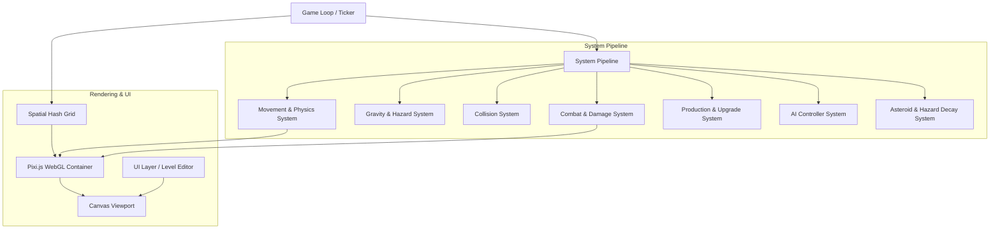

# Architecture Specification: Pea Puffer / Lux

## 1. Overview & System Design

**Pea Puffer / Lux** is a high-performance, real-time strategy (RTS) space game built on an Entity-Component-System (ECS) architecture in TypeScript. It is designed to render and simulate thousands of particle swarm combatants simultaneously at 60 FPS using Pixi.js (WebGL) and optimized Spatial Hashing.

---

## 2. Core Subsystems & Components

### 2.1 Physics, Movement & Spatial Optimization (`src/core`, `src/systems`)
* **`SpatialHash` (`src/core/SpatialHash.ts`)**: Divides the 2D Cartesian game arena into grid buckets to reduce pairwise particle collision checks from $O(N^2)$ to $O(N \cdot k)$.
* **`MovementSystem` (`src/systems/MovementSystem.ts`)**: Handles velocity vectors, acceleration, friction/drag damping, and waypoint steering.
* **`GravitySystem` (`src/systems/GravitySystem.ts`)**: Simulates Newtonian gravitational fields, celestial orbital attraction, white hole repulsion, and black hole event horizons.

### 2.2 Combat & Particle Dynamics (`src/systems`)
* **`CombatSystem` (`src/systems/CombatSystem.ts`)**: Manages particle swarm collisions, composite swarm consolidation, swarm splitting under projectile fire, shield absorption, and planet capture calculations.
* **`ProductionSystem` (`src/systems/ProductionSystem.ts`)**: Regulates planet resource regeneration, production rates based on upgrade levels, and particle deployment queuing.
* **`GammaRaySystem` & `AsteroidSystem` (`src/systems`)**: Dynamic obstacle simulation and cataclysmic zone management.

### 2.3 Artificial Intelligence Subsystem (`src/ai`)
* **`AIController` (`src/ai/AIController.ts`)**: Evaluates global game state, planet ownership balance, and orchestrates personality-driven execution.
* **`AIStrategies` (`src/ai/AIStrategies.ts`)**: Modular strategy executors:
  * *Berserker*: Prioritizes aggressive forward deployment and maximum swarm concentration (`executeBerserkerStrategy`).
  * *Dominator*: Focuses on resource capture, planet fortification, and tactical expansion (`executeDominatorStrategy`).
  * *Expander & Balanced*: Dynamic territorial defense and calculated risk maneuvers.
* **Hazard Avoidance**: Vector steering around black hole gravity wells and plasma storm boundaries.

### 2.4 Scene Management & Level Editor (`src/scenes`, `src/levels`, `src/ui`)
* **Level Schema**: JSON schema defining planet coordinates, initial owner (`player`, `enemy`, `neutral`), production speeds, hazard placements, and speed zones.
* **Level Editor**: Interactive web editor for placing planets, designing speed polygons, and serializing level descriptors to source.

---

## 3. Technology Stack & Tooling

| Component | Technology | Role |
| :--- | :--- | :--- |
| **Language** | TypeScript ~6.0 | Strict static typing and ECS modeling |
| **Renderer** | Pixi.js ^8.19 | WebGL 2D hardware-accelerated particle batching |
| **Bundler & Dev** | Vite ^8.0 | High-speed ESM dev server and tree-shaking |
| **Styles** | TailwindCSS ^3.4 | Dynamic UI and HUD styling |
| **Testing** | Vitest & Pytest | Automated system, unit, and schema test verification |

---

## 4. Automated Test Map

| Test Suite | Target Modules | Coverage |
| :--- | :--- | :--- |
| `tests/test_game_architecture.py` | Package structure, TypeScript config, Vite pipeline | Configuration & Asset Integrity |
| `tests/test_levels_and_schemas.py` | `src/levels/*.json`, Level Schema | Level JSON formatting & entity validation |
| `tests/test_systems_contracts.py` | `src/systems/`, `src/core/`, `src/ai/` | ECS system signatures & game mechanics |
| `src/systems/__tests__/*` | Core TypeScript systems | Unit tests for combat, gravity, movement |
