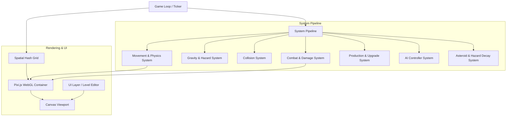

# Architecture Specification: Pea Puffer / Lux

## 1. Overview & System Design

**Pea Puffer / Lux** is a high-performance, real-time strategy (RTS) space game built on an Entity-Component-System (ECS) architecture in TypeScript. It is designed to render and simulate thousands of particle swarm combatants simultaneously at 60 FPS using Pixi.js (WebGL) and optimized Spatial Hashing.

---

## 2. Core Subsystems & Components

### 2.1 Physics, Movement & Spatial Optimization (`src/core`, `src/systems`)
* **`SpatialHash` (`src/core/SpatialHash.ts`)**: Divides the 2D Cartesian game arena into grid buckets to reduce pairwise particle collision checks from $O(N^2)$ to $O(N \cdot k)$.
* **`MovementSystem` (`src/systems/MovementSystem.ts`)**: Handles velocity vectors, acceleration, friction/drag damping, and waypoint steering.
* **`GravitySystem` (`src/systems/GravitySystem.ts`)**: Simulates Newtonian gravitational fields, celestial orbital attraction, white hole repulsion, and black hole event horizons.

### 2.2 Combat & Particle Dynamics (`src/systems`)
* **`CombatSystem` (`src/systems/CombatSystem.ts`)**: Manages particle swarm collisions, composite swarm consolidation, swarm splitting under projectile fire, shield absorption, and planet capture calculations.
* **`ProductionSystem` (`src/systems/ProductionSystem.ts`)**: Regulates planet resource regeneration, production rates based on upgrade levels, and particle deployment queuing.
* **`GammaRaySystem` & `AsteroidSystem` (`src/systems`)**: Dynamic obstacle simulation and cataclysmic zone management.

### 2.3 Artificial Intelligence Subsystem (`src/ai`)
* **`AIController` (`src/ai/AIController.ts`)**: Evaluates global game state, planet ownership balance, and orchestrates personality-driven execution.
* **`AIStrategies` (`src/ai/AIStrategies.ts`)**: Modular strategy executors:
  * *Berserker*: Prioritizes aggressive forward deployment and maximum swarm concentration (`executeBerserkerStrategy`).
  * *Dominator*: Focuses on resource capture, planet fortification, and tactical expansion (`executeDominatorStrategy`).
  * *Expander & Balanced*: Dynamic territorial defense and calculated risk maneuvers.
* **Hazard Avoidance**: Vector steering around black hole gravity wells and plasma storm boundaries.

### 2.4 Scene Management & Level Editor (`src/scenes`, `src/levels`, `src/ui`)
* **Level Schema**: JSON schema defining planet coordinates, initial owner (`player`, `enemy`, `neutral`), production speeds, hazard placements, and speed zones.
* **Level Editor**: Interactive web editor for placing planets, designing speed polygons, and serializing level descriptors to source.

---

## 3. Technology Stack & Tooling

| Component | Technology | Role |
| :--- | :--- | :--- |
| **Language** | TypeScript ~6.0 | Strict static typing and ECS modeling |
| **Renderer** | Pixi.js ^8.19 | WebGL 2D hardware-accelerated particle batching |
| **Bundler & Dev** | Vite ^8.0 | High-speed ESM dev server and tree-shaking |
| **Styles** | TailwindCSS ^3.4 | Dynamic UI and HUD styling |
| **Testing** | Vitest & Pytest | Automated system, unit, and schema test verification |

---

## 4. Automated Test Map

| Test Suite | Target Modules | Coverage |
| :--- | :--- | :--- |
| `tests/test_game_architecture.py` | Package structure, TypeScript config, Vite pipeline | Configuration & Asset Integrity |
| `tests/test_levels_and_schemas.py` | `src/levels/*.json`, Level Schema | Level JSON formatting & entity validation |
| `tests/test_systems_contracts.py` | `src/systems/`, `src/core/`, `src/ai/` | ECS system signatures & game mechanics |
| `src/systems/__tests__/*` | Core TypeScript systems | Unit tests for combat, gravity, movement |

## 5. Refactor boundaries (2026-10-27)

- `simulation/createGameState.ts`: state construction with injectable randomness; never owns DOM/renderers.
- `simulation/SimulationPipeline.ts`: ordered system schedule and spatial index. Preserve ordering when adding systems: orbit → planet collisions → production → movement → gravity → particle collisions → combat → upgrades → enabled hazards → effect aging. The tick-start hash intentionally remains in the same position for gameplay compatibility.
- `systems/PlanetCollisionSystem.ts`: simultaneous moving-planet destruction and stranded units.
- `simulation/maintenance.ts`: stable in-place collection cleanup. Particle and effect array references remain valid.
- `core/CollisionPairTracker.ts`: object ordinals plus an at-most 8 MiB reusable bitset, sparse fallback above 8,192 particles. Does not assume symmetric neighborhoods after movement.
- `ai/WaveTracker.ts`: one live-ID index per tick, preserving wave order and first duplicate-ID semantics. The follow-up AI pass also drops arrived or reassigned members.
- `core/SubscriptionScope.ts`: scene-owned listener teardown. GameScene also explicitly destroys its AI controller.
- `ui/renderUnitGraph.ts`: result-chart presentation, independent of simulation.
- `GameScene`: lifecycle, input/deployment, HUD/tutorial adapters and results. State construction, scheduling and graph drawing no longer belong here; input/deployment and result-overlay UI remain the next useful extraction seams.

Performance evidence: deterministic Node collision-only medians, 20 samples after five warmups. Distributed 5,000 particles: 1.88 → 1.45 ms; dense 1,500: 10.56 → 3.90 ms. Local CPU timing only, not a whole-game FPS guarantee. Reproduce with `npx vitest run src/benchmarks/hotPaths.test.ts --disableConsoleIntercept`.

Phase-one verification: 72 unit tests, 12 Python architecture/level checks, strict TypeScript build, tutorial/pause/quit browser smoke checks, independent code review. Existing gameplay strategy parameters, 28 levels and `lux_*` settings keys retained. Compatible locked dependency updates leave `npm audit` with zero findings at verification time.

## 6. AI and deployment boundaries (v1.8.0)

The follow-up AI work was performed after the optimization pass, in a separate commit.

- `ai/assessSituation.ts`: builds a strategic snapshot with a supplied visibility predicate; counts actual combat strength.
- `ai/ForceAssessment.ts`: shared effective-defense and whole-unit surplus selection. Shield walls and composite attackers now affect opportunity and retreat decisions consistently.
- `simulation/deployment.ts`: applies typed orders to existing units; optional strategy fraction, default half-fleet for humans/tutorials, independent explicit-ID orders for stranded or redirected units. No rendering/audio or synthetic reinforcements.
- `DeployCallback` now carries the optional fraction after waypoint coordinates. The scene adapter passes both waypoint coordinates into their correct slots.
- Waves are registered from actual post-callback unit state, never from intended-but-blocked orders. Membership requires the same live faction, destination, and traveling/combat mode; arrivals and reassignment permanently remove old membership. Capture redirects update the tracked destination.
- `GameScene` records vacated-source events after actual launches, including explicit orbiter deployments. Counterattacks select exact whole-unit IDs within their surplus budget and leave the promised garrison; hopeless planets can evacuate fully.

Existing strategy tables/difficulty names remain intact. Player selection, half-fleet right clicks, tutorial behavior, levels and saved settings remain compatible. Tactical fixtures cover composites, shields, fractions, stranded units, stale waves, redirects and garrison preservation; seeded one-minute simulations cover all three AI difficulties. These verify decisions and state integrity, not a measured improvement in tournament win rate.

Future decomposition: AIController still owns policy branch ordering and campaign memory. Extract target scoring and campaign/cooldown stores behind the existing assessment/order interfaces as those features grow. Editor and menu UI remain separate future cleanup work; they were not rewritten in this pass.

Final v1.8.0 verification: 85 unit/integration tests and 12 architecture/level checks, zero dependency audit findings; independent review resolved stale-wave membership and confirmed garrison preservation.
